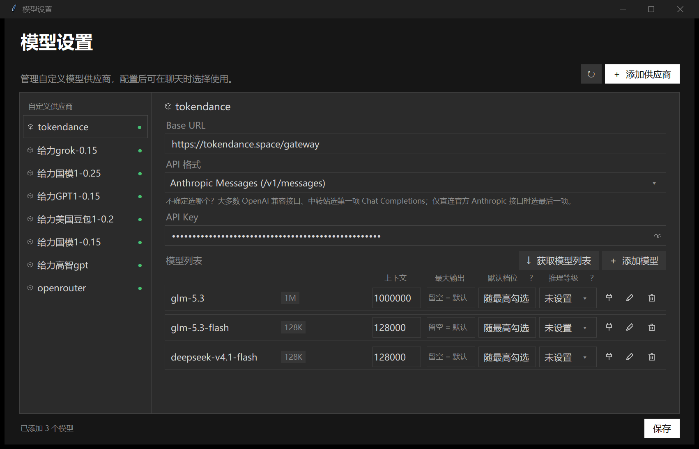

# ZCode 获取模型列表

给 [ZCode](https://github.com/zai-org/ZCode)（智谱）桌面端补一个官方没有的能力：在「模型设置」里按 **Base URL + API Key 自动拉取模型列表**，不用再手填模型 ID。

## 为什么做这个

ZCode 官方的自定义供应商页面需要手动填写模型 ID 和参数。这个工具提供深色单窗口选单：获取候选模型 → 每行选择模型 → 编辑参数 → 保存到 ZCode。关窗即退出，不常驻后台。

## 功能

- 填 Base URL + API Key，一键拉取 `/models` 候选（兼容 `/models` 与 `/v1/models`，支持 Chat Completions / Responses / Anthropic Messages 三种格式）
- 行内编辑：上下文窗口、最大输出（留空=默认）、**推理等级勾选**（可跳档，支持 ultra）、默认档位
- **参数自动补全**：当前供应商配置 → 当前服务商目录 → 内置模型库；保留手动修改与主动清空的字段，切换模型时重新匹配自动填入的参数（详见下节）
- 每行「测试」：用该模型真实发一次最小请求，回报成功/失败 + 耗时 + 中文原因（401 / 超时 / 网络不通）
- 保存写入 `%USERPROFILE%\.zcode\v2\provider_config.json`，写前自动毫秒级备份，未改动的推理等级原样保留
- UI 对齐 ZCode 官方「模型设置」页（色板、字体层级、chips、弹层按 app.asar 实测还原）

## 内置模型库与自动补全

- 获取候选模型后，未手动编辑的空字段按以下优先级补全：
  1. 当前供应商按完整模型 ID 查找已保存配置，不自动套用其他供应商的限额。
  2. 当前服务商 `/models` 返回的元数据。
  3. 内置模型库：ZCode 的家族规则与 OpenRouter 公开目录快照（日期见 `builtin_model_rules.json` 的 `asOf`）。目录参数是参考值，不代表当前中转商一定支持相同限额。
  4. 仍未查到上下文时暂用 128000；最大输出留空，推理等级不猜测。
- 自动补全保留手动值和主动清空操作。换成另一个模型时，自动填入的值会重新匹配；悬停参数可以查看来源。
- 带厂商前缀的 ID 按 `sourceId` 区分；裸型号存在多个来源时，不自动套用有歧义的目录记录。`:batch`、`:free` 等变体单独匹配，不与普通版本混算限额。
- 推理等级支持不连续勾选，界面显示中文、配置保存英文代码；默认档写在 `values` 末尾，沿用 ZCode 的默认选择方式。选择未勾选的默认档前会询问确认。
- 手动输入模型 ID（回车或失焦）走同一条补全链。
- 联网刷新内置库：`python tools/refresh_builtin_models.py`。默认重新请求公开目录，不强制启用本地代理；失败不使用错误响应替换模型库。
- 离线重建：`python tools/refresh_builtin_models.py --offline`。仅使用上次校验通过的缓存，并保留原抓取日期。缓存默认位于 `.iterate/model-cache/`。

## 使用

- 双击本目录的 `获取模型列表.bat`，或 `pythonw app.py`
- 改完点「保存当前供应商」，再回 ZCode 设置页刷新；编辑弹窗的「应用到列表」只更新待保存内容。
- 切换供应商、重新读取或关闭前，工具会提示处理未保存修改。保存前若检测到配置已被其他窗口修改，则拒绝覆盖，请重新读取后再编辑。
- 尽量避免在 ZCode 和本工具中同时保存配置：ZCode 不参与本工具的文件锁，版本检查无法完全消除两个进程同时写入的竞态。
- 或直接下载 [最新 Release](https://github.com/Lyn-Linyanhe/zcode-provider-sync/releases/latest)：Python 3.10+（仅标准库，无第三方依赖），Windows 10/11

## English

A single-window companion for the ZCode desktop app: fetch available models from your provider by Base URL + API Key (the official settings page lacks this), edit context window / max output / reasoning levels inline, auto-fill parameters from a built-in model database, test each model with a real minimal request, and write everything into `~/.zcode/v2/provider_config.json`. Pure-stdlib Python 3.10+, dark UI matching ZCode's own settings page, closes completely on exit.

## 参与开发

欢迎 PR 与 issue：上手方式、代码结构和验收规矩见 [CONTRIBUTING.md](CONTRIBUTING.md)，适合上手的任务看 [`good first issue`](https://github.com/Lyn-Linyanhe/zcode-provider-sync/issues?q=is%3Aissue+is%3Aopen+label%3A%22good+first+issue%22) 标签。

## License

[MIT](LICENSE)
